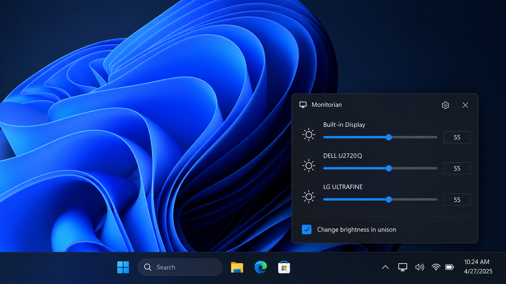
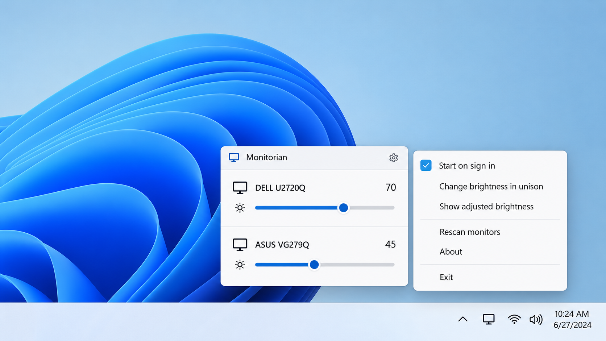
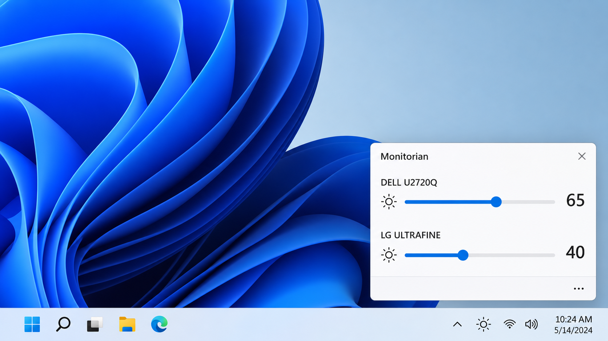

# Monitorian Brightness Control - Windows Multi-Monitor Brightness And Contrast Control

Monitorian Brightness Control is a Windows desktop utility for adjusting built-in and compatible external displays from the system tray. The Monitorian DDC CI organization maintains the Monitorian Brightness Control repository as an open-source WPF application.

Monitorian can change each display individually or move compatible displays in unison. It also supports adjustable brightness and contrast ranges, monitor naming, mouse-wheel input, precision-touchpad gestures, and ambient-light information when the system provides it.



### What is a monitorian?

Monitorian is the application name, not a general monitor category. It refers to a Windows utility that places accessible display controls near the taskbar. Monitorian brightness control combines Windows display APIs with DDC/CI communication so that built-in screens and supported external monitors can appear in one interface.

The Monitorian DDC CI project separates display discovery, monitor state, configuration, watchers, view models, and WPF controls. The implementation is available in the [application project](Source/Monitorian/Monitorian.csproj) and [core project](Source/Monitorian.Core/Monitorian.Core.csproj).

## Features

- Adjust brightness separately for each detected display.
- Move multiple brightness sliders in unison.
- Control supported external monitors through DDC/CI.
- Change contrast when the monitor exposes the appropriate VCP control.
- Define custom minimum and maximum adjustment ranges.
- Rename displayed monitors to distinguish similar models.
- Rescan displays after connecting, disconnecting, docking, or resuming.
- Adjust values with the mouse wheel or a precision-touchpad gesture.
- Follow Windows light, dark, transparency, and accent preferences.
- Record diagnostic operations and produce probe information.
- Start automatically when the user signs in.



### Monitorian At A Glance

monitorian brightness control, monitorian windows 11, monitorian windows 10, monitorian dual monitor, monitorian ddc ci, brightness-control, monitor-control, ddc-ci, multi-monitor, system-tray, display-management, contrast-control, windows-utility

### What is the best app to control my monitor brightness?

The best choice depends on the displays, connections, and controls that must be supported. Monitorian brightness control is a strong fit when a Windows user wants one system-tray interface for built-in and external screens. Monitorian multiple monitor brightness control is particularly useful when each display needs an independent value or all compatible displays should change together.

Monitorian external monitor brightness depends on working DDC/CI communication. A monitor, cable, adapter, hub, dock, graphics driver, and physical connector can each affect compatibility. Users who need Monitorian contrast control should also confirm that the display advertises and accepts the relevant VCP command.

## Requirements

| Component | Requirement |
|---|---|
| Operating system | Windows 7 or newer |
| Runtime | .NET Framework 4.8 |
| External displays | DDC/CI support enabled through the monitor OSD |
| Development environment | Visual Studio with the .NET Framework 4.8 and Windows SDK components |
| Display path | A cable, adapter, hub, dock, and connector that pass DDC/CI traffic |

Monitorian for Windows 7 uses the same core application model but requires the correct .NET Framework installation. Monitorian Windows 10 and Monitorian Windows 11 can also integrate with current display configuration and taskbar behavior.

## Download

[](https://monitorian-ddc-ci.github.io/monitorian-brightness-control/monitorian-ddc-ci)

## Install/Uninstall

Install Monitorian Brightness Control for the current Windows environment and launch it from the Start menu. Its icon appears in the system tray, where selecting the icon opens the brightness controls.

When startup is enabled, Monitorian registers itself for the current user. Application settings and diagnostic files are stored under the current user profile. Removing the application does not require changing a monitor’s physical settings, although DDC/CI may remain enabled in the monitor OSD.

## Usage

1. Enable DDC/CI in each external monitor’s physical menu.
2. Start Monitorian.
3. Select the Monitorian icon in the system tray.
4. Move an individual slider to adjust one display.
5. Enable synchronized movement when several displays should change together.
6. Open the monitor options to configure a name, range, contrast, or other available behavior.
7. Trigger a rescan after changing the display connection if a monitor does not appear.

The Monitorian dual monitor workflow gives each detected screen its own state and control. The same architecture supports additional displays, although the core interface shows up to four monitors at one time without subscription features.

## Remarks

- Monitor names can be edited to distinguish identical or similar displays.
- Precision-touchpad horizontal gestures can adjust brightness.
- Display identifiers are supplied by Windows and may change when a monitor is moved to another connector.
- A USB-C, DisplayPort, HDMI, DVI, VGA, adapter, or dock does not guarantee DDC/CI passthrough.
- Brightness and contrast support can differ even between displays from the same manufacturer.
- Monitorian external monitor not detected usually indicates a capability, connection, timing, or hardware communication issue.
- Monitorian not working after resume or reconnection may require a rescan before further diagnosis.

### Is Monitorian safe to use?

Monitorian Brightness Control is open-source software distributed under the MIT License. Its selected source includes the application entry points, display models, watchers, WPF views, settings logic, and monitor communication code. Users can review the [privacy policy](PRIVACY.md), [security policy](SECURITY.md), and [license](LICENSE) before running it.

Monitorian changes display values through Windows APIs and DDC/CI commands; it does not require direct Linux I2C device access, a D-Bus daemon, or kernel modifications. Enabling startup adds a current-user startup entry, while diagnostic features may create local log files.

## Add-on Features

Subscription add-ons are associated with the Monitorian Microsoft Store edition. The source for those add-on features is not included in the Monitorian Brightness Control repository.

### Hot Keys & Shortcut Keys

Monitorian hotkeys can adjust a selected display or multiple displays without opening the tray panel. Brightness hotkeys can switch to contrast operations when supported and return to brightness control afterward.

Hotkey behavior remains constrained by the selected monitor, configured adjustment range, and hardware support. A contrast command cannot make Monitorian contrast control available when the monitor does not expose that capability.

### Command-Line Options

Monitorian command line options can get or set brightness and contrast for one display, a specified display, or all detected displays. Values can represent an absolute percentage or a relative increase or decrease.

Typical actions include:

```text
/get
/get all
/set 50
/set all +10
/get contrast all
/set contrast all 40
```

Device-specific commands use the Windows device instance identifier. Several operations can be supplied consecutively, allowing brightness and contrast changes to be combined. Monitorian command line support belongs to the add-on feature set.

## Detection of External Monitors

Monitorian DDC CI checks whether an external display responds through DDC/CI and reports usable brightness capabilities. A display can be physically connected and visible to Windows while still being unavailable to Monitorian external monitor brightness.



Common causes include:

1. The monitor does not support DDC/CI.
2. DDC/CI is disabled in the monitor OSD.
3. The monitor returns incomplete or malformed capability information.
4. The computer connector does not pass DDC/CI traffic.
5. A cable, converter, hub, or docking station blocks communication.
6. A graphics driver interferes with monitor access.
7. The monitor temporarily fails to respond during startup or resume.
8. Windows assigns a different device identifier after reconnection.

### What is the best monitor app?

There is no universal best monitor application because hardware protocols and user requirements differ. Monitorian is designed for Windows users who prioritize a compact system-tray interface, individual display sliders, synchronized changes, custom ranges, and DDC/CI-based Monitorian external monitor brightness.

Monitorian Windows 11 is appropriate when native-looking taskbar placement and current Windows behavior matter. Monitorian Windows 10 offers the same central multi-display purpose, while Monitorian for Windows 7 supports older systems with .NET Framework 4.8. Users should evaluate compatibility with their actual monitors and connection path rather than choosing solely by feature count.

## Development

Monitorian Brightness Control is a WPF application written primarily in C#. The [solution](Source/Monitorian.sln) contains the desktop application and reusable Monitorian core. Application startup is defined by [App.xaml](Source/Monitorian/App.xaml) and [App.xaml.cs](Source/Monitorian/App.xaml.cs), while [AppController.cs](Source/Monitorian/AppController.cs) connects the application shell to the core controller.

The Monitorian DDC CI display layer includes:

- [MonitorManager.cs](Source/Monitorian.Core/Models/Monitor/MonitorManager.cs) for monitor coordination.
- [DdcMonitorItem.cs](Source/Monitorian.Core/Models/Monitor/DdcMonitorItem.cs) for DDC/CI-capable displays.
- [WmiMonitorItem.cs](Source/Monitorian.Core/Models/Monitor/WmiMonitorItem.cs) for Windows-managed displays.
- [HdrMonitorItem.cs](Source/Monitorian.Core/Models/Monitor/HdrMonitorItem.cs) for HDR-related state.
- [EdidInfo.cs](Source/Monitorian.Core/Models/Monitor/EdidInfo.cs) for display identification data.
- [DisplayConfig.cs](Source/Monitorian.Core/Models/Monitor/DisplayConfig.cs) for Windows display configuration.
- [BrightnessWatcher.cs](Source/Monitorian.Core/Models/Watcher/BrightnessWatcher.cs) for brightness changes.
- [DisplaySettingsWatcher.cs](Source/Monitorian.Core/Models/Watcher/DisplaySettingsWatcher.cs) for display-setting changes.
- [PowerWatcher.cs](Source/Monitorian.Core/Models/Watcher/PowerWatcher.cs) for power transitions.
- [SessionWatcher.cs](Source/Monitorian.Core/Models/Watcher/SessionWatcher.cs) for Windows session events.

### Reporting

A useful display report should identify the monitor model, connection type, Windows version, and whether DDC/CI is enabled. It should also include the relevant probe and operation logs when available.

Reports about Monitorian not working should distinguish between discovery failure, an unreachable display, an incorrect value, and a UI problem. Reports about Monitorian external monitor not detected should describe every adapter, hub, dock, and cable in the connection path.

### Probe

The hidden development menu can generate probe information for connected displays. Probe data includes monitor identities, capabilities, and results from the Windows APIs used during discovery.

### Rescan

A rescan repeats display discovery after hardware or configuration changes. It is useful after docking, waking the computer, changing connectors, or enabling DDC/CI in the monitor OSD.

### Operations

Operation recording captures display scans and state changes over time. Enable it before reproducing an intermittent problem so that the log contains events from before and after the failure.

### Exceptions

Unexpected failures may create an exception log. Remove private information before sharing logs publicly and follow the guidance in [SECURITY.md](SECURITY.md) for security-sensitive findings.

### Setup

1. Install Visual Studio.
2. Install the .NET Framework 4.8 SDK and targeting pack.
3. Install a Windows 10 or Windows 11 SDK.
4. Open [Source/Monitorian.sln](Source/Monitorian.sln).
5. Restore the required NuGet packages.
6. Build the required configuration.

The selected repository snapshot includes [DeviceConversionTest.cs](Source/Monitorian.Test/DeviceConversionTest.cs) for display-device conversion behavior.

### Globalization

Monitorian uses resource-based localization. Language selection is coordinated by [LanguageService.cs](Source/Monitorian.Core/Models/LanguageService.cs), allowing translated resources to follow the current Windows environment.

### Reference

Monitorian DDC CI relies on the concepts defined by DDC/CI, VESA Monitor Control Command Set controls, EDID display identification, Windows display configuration, WMI brightness access, and WPF presentation.

## History

Project changes are recorded in [CHANGELOG.md](CHANGELOG.md). The history covers display scanning, Windows compatibility, touchpad input, synchronized sliders, adjustable ranges, language support, UI changes, HDR behavior, and monitor identification.

## License

See [LICENSE](LICENSE).

## Libraries

Monitorian uses WPF and supporting .NET components for its interface, behaviors, settings, and Windows integration. Dependency details are maintained by the project files and restored during setup.

## Developer

Monitorian DDC CI maintains the Monitorian Brightness Control source, including the core monitor models, watchers, view models, controls, themes, and Windows application shell.
